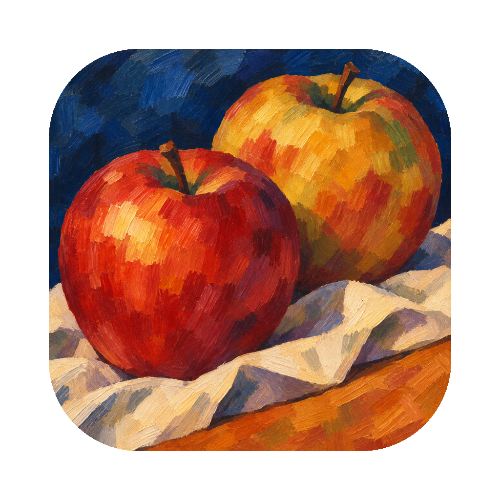

# Cezane

Un écosystème de montage vidéo sur mon Mac, piloté par Claude, pour créer des vidéos verticales
rapidement. Je donne des rushes et des consignes, Claude monte avec des outils typés, je relis le
rendu final et je commente directement dessus ; Claude corrige et une nouvelle version sort.

L'architecture est dans [archi/](archi/README.md) ; l'état de la v0.1 est dans
[archi/v0.1.md](archi/v0.1.md).

## Lancer

Prérequis : Bun 1.3, ffmpeg 8 (Homebrew), `whisper-cpp` (Homebrew) et le modèle
`~/Cezane/models/ggml-large-v3-turbo-q5_0.bin`, Google Chrome, Xcode (helper Swift), Claude Code
connecté à l'abonnement. Codex CLI est optionnel (génération d'images gratuite sur l'abonnement
ChatGPT).

```sh
bun install
bun run build:ui                       # construit l'interface (servie par le serveur)
bun run app -- demo/cezane-demo        # Electron : lance le serveur et ouvre l'app
# ou sans Electron :
bun run serve demo/cezane-demo         # puis http://127.0.0.1:4317
```

## La CLI

```sh
bun run cezane init <dossier> [--name N]
bun run cezane serve [dossier] [--port 4317]  # un serveur pour tous les projets ; dossier = projet par défaut
bun run cezane projects                                  # liste les projets (ids)
bun run cezane import <fichiers…> [--capture ios|web --target T]
bun run cezane tool <outil> '<json>' [--out image.jpg]   # appelle un outil MCP comme Claude
bun run cezane edit '<ops json>' [--reason r]
bun run cezane render [résumé]                            # rend une version et attend
bun run cezane send [ids…]                                # envoie les commentaires à Claude
bun run cezane agent "<consigne>"                         # Claude travaille sur le projet
bun run cezane state
# les commandes de projet visent le projet par défaut, ou --project <id>
```

Le serveur MCP est sur `http://127.0.0.1:4317/mcp` (projet par défaut) et
`http://127.0.0.1:4317/api/p/<id>/mcp` (chaque projet) : il marche aussi depuis un Claude Code ouvert
dans un terminal (`claude mcp add --transport http cezane http://127.0.0.1:4317/mcp`). Projets,
dossiers Finder et routes : [archi/projets.md](archi/projets.md).

## Organisation

| Dossier | Rôle |
|---|---|
| `packages/core` | modèles Zod (projet, montage, commentaires, versions), opérations d'édition, segments, résumé |
| `packages/engine` | ingestion ffmpeg/whisper, mixage audio, rendu par segments, look, détourage, capture, génération |
| `packages/remotion` | composition `Timeline`, grille `Look`, bibliothèque de motion design, worker de rendu |
| `packages/server` | stockage du projet (révisions, versions), API HTTP + SSE, outils MCP, boucle Claude, CLI |
| `packages/app` | interface Electron + React (montage, canvas tldraw, commentaires, activité de Claude) |
| `native/vision` | helper Swift : détourage de personne avec Apple Vision |
| `assets/brand` | icône, logo et images d'ambiance façon Cézanne, générés avec Codex |
| `demo/` | trois projets : la démo de Cezane, l'explication de Rewind, l'explication de Dax |

## Les projets de démo

Chaque projet versionne ses documents (`cezane.json`, montage, canvas, commentaires, versions) ;
les médias et les caches ne sont pas dans git. Les scripts de `demo/scripts/` reconstruisent les
montages Rewind et Dax depuis un serveur lancé sur le projet.

- `demo/cezane-demo` : toutes les fonctionnalités (montage par Claude, coupe des silences,
  accroche native, sous-titres, texte derrière la personne, green screen, b-roll, scènes de
  capture avec curseur, musique sous la voix, canvas avec génération Codex et Claude, versions et
  commentaires corrigés).
- `demo/rewind` : vidéo de docs de Rewind en 16:9 (captures web dans une fenêtre, curseur,
  loupe, poussée de caméra), sans voix, musique tendance.
- `demo/dax` : vidéo d'onboarding de Dax en vertical (captures du simulateur iOS dans un iPhone,
  curseur à la Figma, loupe), sans voix, musique tendance.
